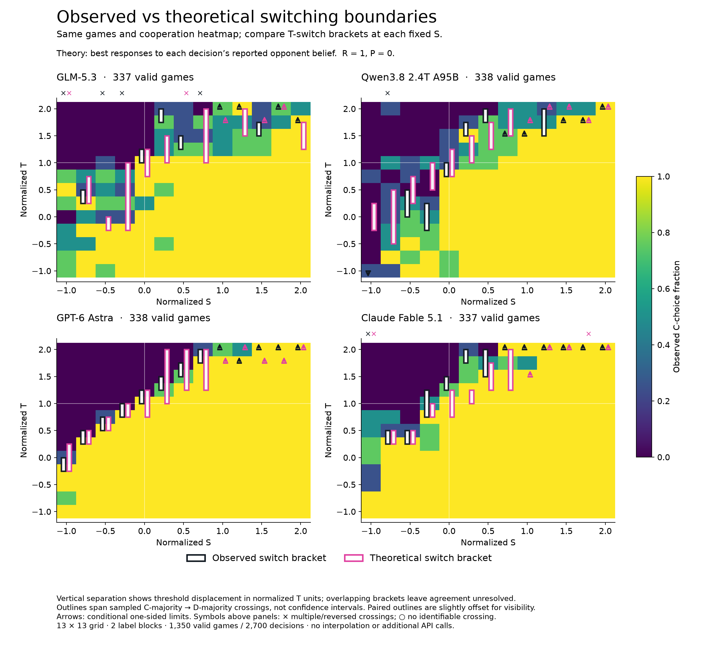

# Figures for a LessWrong post on payoff incentives

Four figures: use figures 1 and 2 for the empirical results, figure 3 to explain the theoretical game regions, and figure 4 to show the presentation effect that motivated the clearer-payoff experiment. “Susceptibility” is operationalized here as response to payoff incentives. These are descriptive data with few repeats per cell, not universal model rankings.

The full experiment contains 10,096 calls / 5,048 paired simulations (including pilots and controls), with 10,066 valid decisions and 5,021 fully valid joint outcomes. The own-payoff grid used in the lead figures has 2,704 calls and 1,350 fully valid games across two blocks. Total accounted API cost was $40.4406, including a $0.045349425 reserve for one unreturned request. No new calls were made for this figure set.

The data were collected on 2026-10-09 UTC. “results oct 10” is the requested repository folder name.

Scientific basis: [Falmagne, The Phase Space of Symmetric 2×2 Games](https://www.siam.org/publications/siam-news/articles/the-phase-space-of-symmetric-2x2-games/). The article gives an analytic classification; the LLM experiment is our extension.

## Claims these figures support

- Choices change across the payoff landscape under the specified individual-utility objective.
- Sampled majority-choice crossings can differ from conditional best-response crossings under reported beliefs.
- Presentation materially affects observed behavior.
- Theoretical indifference and dominance thresholds can be calculated exactly.

## Claims these figures do not establish

- Precise population switching thresholds, statistically significant threshold shifts, a universal ranking, or a general AI-safety score.
- That higher C frequency always means better reasoning or higher joint welfare.
- That disagreement with one mixed-equilibrium branch is irrational.
- That reported beliefs are truthful or faithfully describe the reasoning process.

## Main figure 1: response to payoff incentives

**Cooperation frequency across normalized payoffs**

Each panel shows one model in isolated, simultaneous self-play. We normalize payoffs to R=1 and P=0, varying S horizontally and T vertically on a 13×13 grid with spacing 0.25. Color is the fraction of individual C choices, averaged within valid joint games: yellow means all observed choices were C and purple means all were D. C and D are analytical labels; prompts used neutral A/B labels, reversed across two blocks. Each cell contains at most two valid games (four decisions). Dashed/red regime boundaries at S=0 and T=1 separate dominance, coordination, and anti-coordination regions. The clearer own-payoff presentation was an exploratory follow-up. Here “susceptibility” means observed response to payoff incentives, not a safety or manipulation score. Most cells are not strict Prisoner’s Dilemma; strict PD occupies S<0, T>1.

[PNG](01_cooperation_susceptibility.png) · [Editable SVG](01_cooperation_susceptibility.svg)

## Main figure 2: observed versus theoretical switching boundaries

**Switching thresholds on the S–T cooperation map**

Each panel uses exactly the same complete valid games as Figure 1: GLM 337, Qwen 338, Astra 338, Fable 337 (1,350 games and 2,700 decisions). Color remains observed C-choice frequency on the 13×13 normalized S–T grid. At each held-fixed S, black outlined vertical bands bracket the observed C-majority to D-majority crossing as T increases; pink bands bracket the corresponding theoretical crossing. Paired outlines are slightly offset horizontally for visibility but represent the same S. Vertical separation measures displacement in normalized T units; overlapping bands leave a difference unresolved at this resolution. Theory classifies each decision using its own reported opponent cooperation probability q and Δ=q(1−T)+(1−q)S. Positive Δ favors C, negative Δ favors D, and zero permits either. The theoretical C frequency is therefore an admissible range at ties. Beliefs vary across cells: this is a conditional best-response comparison, not a unique Nash-equilibrium prediction. Brackets span consecutive decisive samples, including intervening ties; no continuous boundary or midpoint threshold is fitted. Arrows mark one-sided limits conditional on a single-switch continuation, × multiple/reversed crossings, and ○ no identifiable crossing. The bands are descriptive grid-resolution ranges, not confidence intervals. Both T and S sweep brackets and their displacement ranges are provided in the CSV. Across those 104 slices, 48 comparisons are two-sided, 16 one-sided, 13 multiple/reversed, and 27 unresolved; these are derived slice counts, not counts of independent experiments. No new API calls or binary search were used.

[PNG](02_threshold_boundary_map.png) · [Editable SVG](02_threshold_boundary_map.svg)

## Figure 3: theoretical context

**The theoretical phase space of symmetric two-action games**

Positive affine normalization maps payoffs to s=(S−P)/(R−P) and t=(T−P)/(R−P), for R>P. This leaves two degrees of freedom and preserves expected-utility incentives. The map shows twelve strict payoff orderings, regime boundaries, and group-payoff boundaries. The repository’s (5,3,1,0) baseline is at (s,t)=(−0.5,2). It is an analytic reconstruction following Falmagne’s SIAM article; no model calls are involved.

[PNG](03_analytic_game_map.png) · [Editable SVG](03_analytic_game_map.svg)

## Figure 4: presentation control

**Matrix presentation substantially changes apparent cooperation**

The targeted exploratory control compares the same strict-PD payoff cells and first two label blocks under row/column wording and explicit “your payoff / opponent payoff” wording. Each bar contains 32 valid decisions per model and role. Qwen’s column-role C frequency changes from 31/32 to 1/32, while its row-role frequency changes from 0/32 to 2/32. The game utilities and individual-payoff objective are identical, but both payoff perspective and display order change. These observations demonstrate presentation sensitivity without isolating its cause. This control motivated the clearer-presentation grid used in figures 1 and 2.

[PNG](04_presentation_control.png) · [Editable SVG](04_presentation_control.svg)

## Threshold data

[All 104 sweep slices and crossing brackets](threshold_displacements.csv) · [Cell counts, theoretical ranges, and source IDs](threshold_cells.csv)
